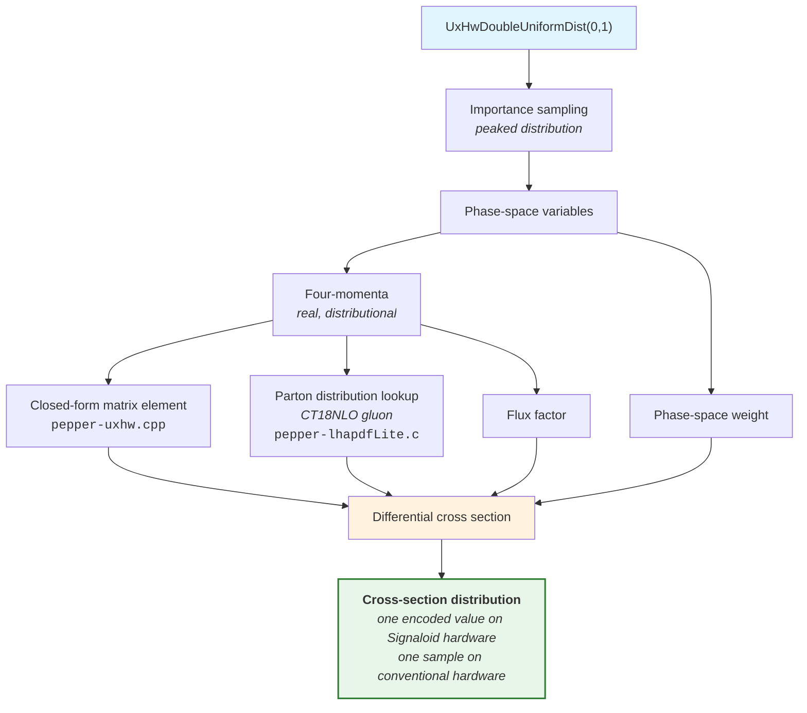

[](https://signaloid.io/repositories?connect=https://github.com/signaloid/Signaloid-Demo-Physics-Pepper#gh-dark-mode-only)
[](https://signaloid.io/repositories?connect=https://github.com/signaloid/Signaloid-Demo-Physics-Pepper#gh-light-mode-only)


# Pepper: Parton-Level Cross Section with Signaloid UxHw® Support

This application computes the leading-order parton-level cross section for
gluon-gluon scattering at Large Hadron Collider energies. It combines the
closed-form matrix element for the process, the CT18NLO parton distribution
functions, and the t-channel phase-space mapping of
[arXiv:2302.10449](https://arxiv.org/abs/2302.10449). The application is a C++
port of the MCnet Schools Stirling 2025 Python tutorial, structured to fit
within the [Signaloid UxHw benchmarking template](https://github.com/signaloid/Signaloid-Demo-Benchmarking-C-Template.git),
so that traditional Monte Carlo sampling and Signaloid's single-pass
distribution arithmetic can be compared directly.

On Signaloid hardware, the phase-space variables are drawn as distributional
values by `UxHwDoubleUniformDist(0, 1)`. Every downstream operation, covering
the phase-space map, the matrix element, the parton distribution lookup and the
flux factor, propagates those distributions. The cube integral is then read
back as the first moment of the propagated differential cross section, with no
sampling anywhere in the pipeline.

On conventional hardware, the same source runs as an ordinary Monte Carlo event
generator. The compatibility layer in `submodules/compat` makes each
`UxHwDoubleUniformDist()` call return one pseudo-random sample, and the outer
loop accumulates the sample mean.


## Cloning the repository

```bash
git clone --recursive https://github.com/signaloid/Signaloid-Demo-Physics-Pepper.git
```

To update all submodules:
```bash
git pull --recurse-submodules
git submodule update --remote --recursive
```

If you forgot to clone with `--recursive`:
```bash
git submodule update --init --recursive
```


## Quickstart

### Prerequisites

The native build needs GNU Make, a compiler with C++11 support, and the GNU
Scientific Library, which backs the UxHw compatibility layer. Nothing else is
required, because the parton distribution reader is self-contained.

On Linux (Debian or Ubuntu):
```bash
sudo apt-get install -y build-essential libgsl-dev
```

On macOS, install the Xcode command line tools and then install the GNU
Scientific Library with [Homebrew](https://brew.sh):
```bash
xcode-select --install
brew install gsl
```

The top-level `Makefile` finds the library automatically for MacPorts
(`/opt/local`), Homebrew on Apple silicon (`/opt/homebrew`) and Homebrew on
Intel (`/usr/local`), so macOS needs no further configuration.

### Native build and run

```bash
make local-build                      # produces ./demo-native-mc
make local-run                        # one distributional pass through the UxHw compatibility layer

./demo-native-mc -S 0 -M 1000000 -T   # Monte Carlo, and print the kernel CPU time
./demo-native-mc -S 0 -j              # JSON output
```

The native build uses gcc by default. Clang is also supported. To build with clang, run
```bash
make local-build CC=clang CXX=clang++
```

The application reads the CT18NLO grid from `inputs/`, resolved relative to the
working directory, so both `make` targets and a direct invocation from the
repository root work without any environment setup. In Monte Carlo mode the
application writes `data.out`, whose first line is the kernel execution time in
microseconds and whose second line is the output value.

### Command-line options

```
Usage: Valid command-line arguments are:
	[-i, --input <Path to input CSV file : str>] (Read inputs from file.)
	[-o, --output <Path to output CSV file : str>] (Specify the output file.)
	[-S, --select-output <output : int>] (Compute 0-indexed output, by default 0. Set to the number of outputs to compute all outputs.)
	[-M, --multiple-executions <Number of executions : int (Default: 1)>] (Repeatedly execute kernel for benchmarking. Also enables timing.)
	[-T, --time] (Timing mode: Times and prints the timing of the kernel execution.)
	[-v, --verbose] (Verbose mode: Prints extra information about demo execution.)
	[-j, --json] (Print output in JSON format.)
	[-h, --help] (Display this help message.)
```


## Output index

| `-S` | Name | Description |
|------|------|-------------|
| 0 | `xs` | Integrated cross section, in `pb` |

The application exposes a single output. Without `-M` it takes one
distributional pass and contracts the propagated differential cross section to
its first moment. With `-M n` it draws `n` scalar phase-space samples and
reports their mean.


## Overview of the source code

| File | Description |
|------|-------------|
| `src/pepper.cpp` | Entry point, argument parsing, mode dispatch, output formatting |
| `src/pepper-kernel.cpp` | Shared setup, shared access to the parton distribution, and the contraction to a first moment or a sample mean |
| `src/pepper-uxhw.cpp` | Distributional kernel, with each table lookup and gate wrapped in `UxHwDoublePropagateFunction` |
| `src/pepper-monteCarlo.cpp` | Scalar kernel and the Monte Carlo sampling loop |
| `src/pepper-lhapdfLite.c` | Self-contained C reader for the CT18NLO grid |
| `src/pepper-utilities.cpp` | Demo-specific argument handling and the output index enumeration |

[`src/README.md`](src/README.md) describes each file in more detail.

### Parton distribution backend

`src/pepper-lhapdfLite.c` reads the CT18NLO grid directly, providing
`xf(x, Q²)` by log-bicubic interpolation and `α_s(Q²)` by cubic interpolation.
It uses only `fopen`, `fgets` and `strtod`, with no C++ streams, no YAML parser
and no exceptions, which is what lets the same reader serve both the native and
the Signaloid builds. Its output was checked against the reference LHAPDF6
implementation and agrees to a maximum absolute difference of 1.4 × 10⁻¹⁴.

### Physics parameters

| Parameter | Value |
|-----------|-------|
| Center-of-mass energy | 13000 GeV |
| Transverse momentum cut | 30 GeV |
| Rapidity bound | 5.0 |
| Factorization scale | 91.1876² GeV² |
| Parton distribution | CT18NLO member 0, gluon |
| Importance sampling exponent | 2.0 |
| Unit conversion | 3.89379656 × 10⁸ from GeV⁻² to `pb` |

### Distribution propagation




## References

The physics implemented here draws on the following works. Entries link to a
canonical source, so nothing third-party is redistributed.
[`docs/README.md`](docs/README.md) collects the same index in one place.

- Hou, T.-J. et al. (2021). "New CTEQ global analysis of quantum chromodynamics with high-precision data from the LHC." *Physical Review D*, 103, 014013.
  [arXiv:1912.10053](https://arxiv.org/abs/1912.10053)
  Used in: `pepper-lhapdfLite.c`, as the CT18NLO parton distribution set.
- Buckley, A. et al. (2015). "LHAPDF6: parton density access in the LHC precision era." *European Physical Journal C*, 75, 132.
  [arXiv:1412.7420](https://arxiv.org/abs/1412.7420)
  Reference implementation that `pepper-lhapdfLite.c` was validated against.

### Signaloid documentation
- [Signaloid Developer Documentation](https://docs.signaloid.io)
- [UxHw API Reference](https://docs.signaloid.io/docs/uxhw-api/)
